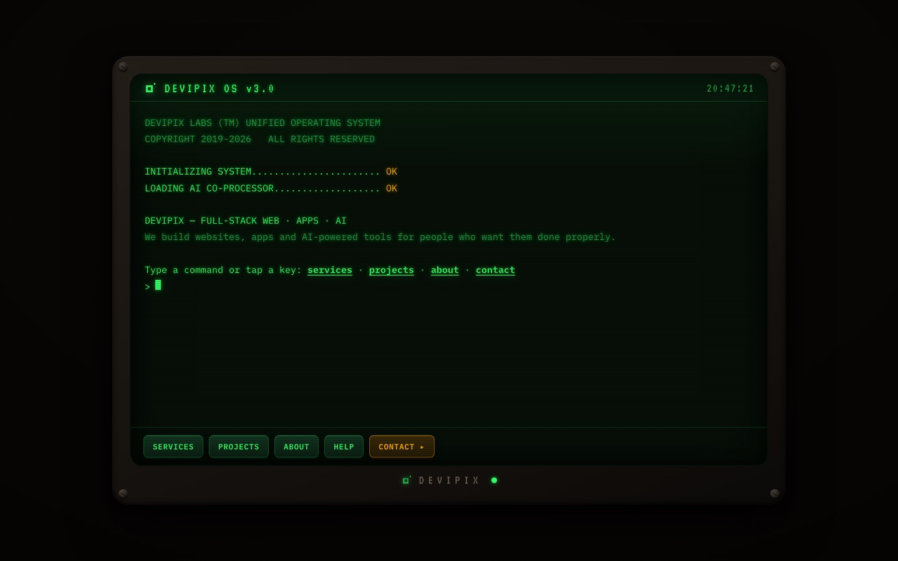

# DeviPix — Retro Terminal Website

Marketing site for **DeviPix**, a studio that builds websites, apps and AI-powered tools. The whole site is a **retro CRT terminal**. Visitors can type commands or tap buttons, and content opens in pop-up windows. An optional AI assistant answers questions about services and pricing.



## Highlights

- **Terminal UI in plain HTML/CSS/JS.** It has a boot sequence, command parsing, command history (↑) and clickable shortcuts for non-technical visitors. No framework and no build step.
- **AI co-processor.** A Cloudflare Worker (`worker.js`) proxies chat requests to the Anthropic API, so the API key never reaches the browser. If no endpoint is configured, the site works fully without AI.
- **Accessible and lightweight.** It respects `prefers-reduced-motion`, uses ARIA labels and a live region for terminal output, and is a single ~40 KB HTML file.
- **SEO-ready.** Open Graph image, `sitemap.xml`, `robots.txt`, a custom 404 page and a privacy page.

## Tech stack

HTML · CSS · vanilla JavaScript · Cloudflare Workers · Cloudflare Pages · Formspree (contact form)

## Run locally

```bash
./run.sh          # opens index.html in your browser
```

Deployment steps (Cloudflare Pages + Worker) are in [DEPLOY.md](DEPLOY.md).
